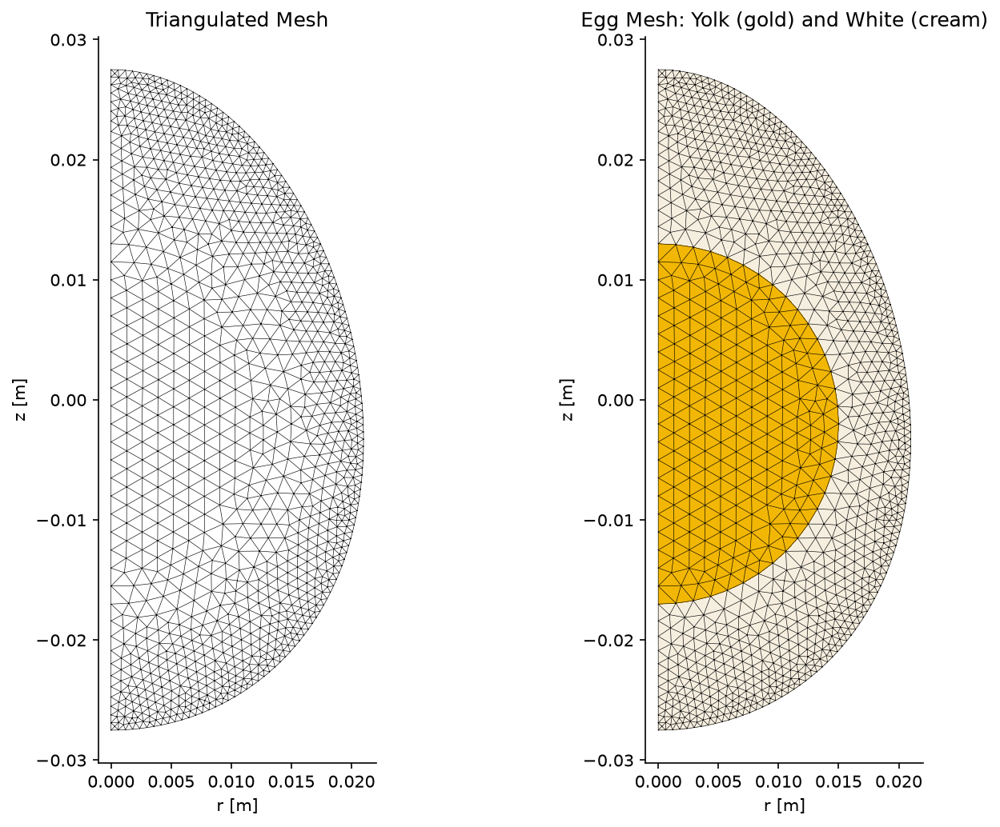
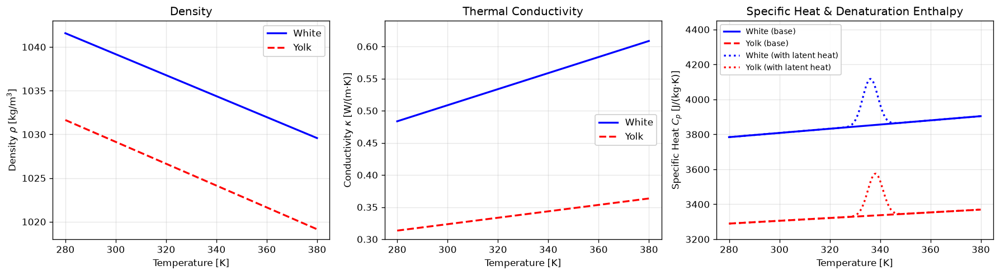
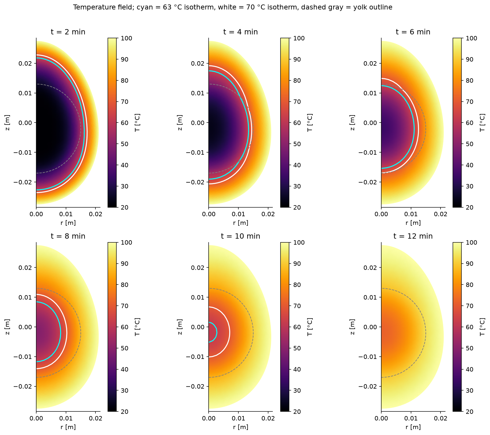
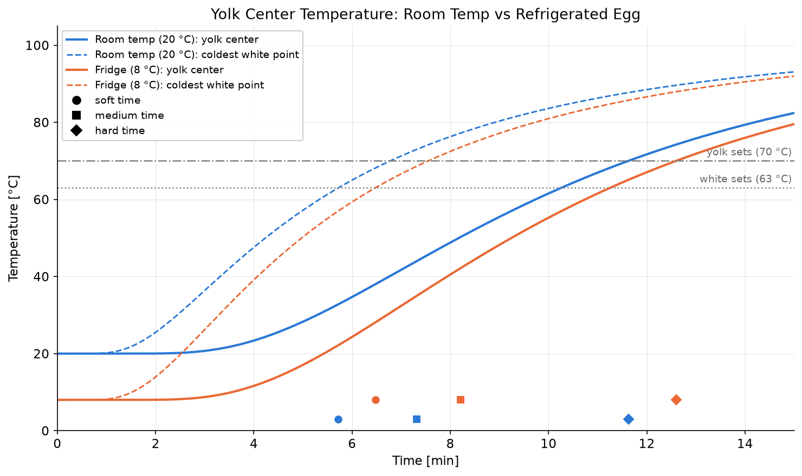
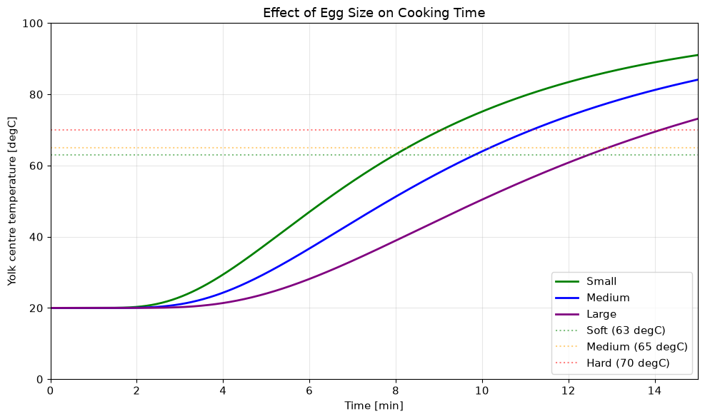
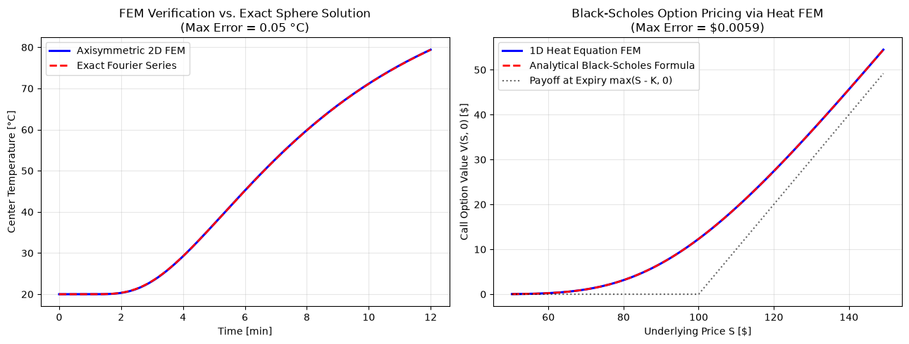

# How Long to Boil an Egg? FEM Modeling with Python

A finite element simulation of heat transfer during egg boiling, solving the axisymmetric transient heat equation:

$$\rho(T)\,C_p(T)\,\frac{\partial T}{\partial t} = \nabla \cdot \bigl(\kappa(T)\,\nabla T\bigr)$$

Built with [scikit-fem](https://github.com/kinnala/scikit-fem) and [gmsh](https://gmsh.info/), this project models the temperature evolution inside an egg immersed in boiling water, predicting cooking times for soft-, medium-, and hard-boiled eggs.

## Reference

This project is a Python re-implementation inspired by the Wolfram Language blog post:

> **How Long to Boil an Egg? FEM Modeling with Wolfram Language**
> Wolfram Blog, September 15, 2025
> https://blog.wolfram.com/2025/09/15/how-long-to-boil-an-egg-fem-modeling-with-wolfram-language/

## Project Structure

```
fem_boil_egg/
├── environment.yml               # Conda environment specification
├── requirements.txt              # pip dependencies
├── egg_fem/                      # Core Python package
│   ├── __init__.py
│   ├── materials.py              # Temperature-dependent & latent-heat material properties
│   ├── geometry.py               # Mesh generation (circular + egg-shaped)
│   ├── solver.py                 # Axisymmetric FEM heat solver (Dirichlet & Robin BCs)
│   └── options.py                # Black-Scholes heat FEM & Monte Carlo egg option pricing
├── figures/                      # Generated simulation plots for documentation
├── tests/
│   └── test_egg_fem.py              # Automated unit and physics verification tests
└── notebooks/
    ├── 01_simple_model.ipynb        # Simple spherical geometry & exact Fourier verification
    ├── 02_realistic_model.ipynb     # Egg-shaped geometry, yolk insulator effect & axial profile
    ├── 03_cooking_analysis.ipynb    # Cooking time predictions & parameter studies
    └── 04_egg_options_pricing.ipynb # Black-Scholes heat FEM, corridor & American egg options
```

## Setup

### With conda (recommended)

```bash
conda env create -f environment.yml
conda activate fem-boil-egg
```

### With pip

```bash
python -m venv .venv
source .venv/bin/activate   # or .venv\Scripts\activate on Windows
pip install -r requirements.txt
pip install jupyterlab pytest
```

### Run the tests

```bash
pytest
```

### Run the notebooks

```bash
jupyter lab notebooks/
```

## Notebooks

### 1. [Simple Model](notebooks/01_simple_model.ipynb)

Introduces the axisymmetric FEM approach on a semicircular cross-section with constant material properties. Demonstrates mesh generation, solver setup, and benchmarks the 2D axisymmetric FEM solution against the exact analytical 3D Fourier-Bessel series for a homogeneous sphere.

### 2. [Realistic Model](notebooks/02_realistic_model.ipynb)

Adds a realistic egg-shaped geometry (parametric B-spline profile), separate yolk and white regions with distinct temperature-dependent material properties, and refined meshing near the shell boundary. Quantifies the **thermal insulator effect of the yolk** against a homogeneous all-white egg and visualizes the **axial temperature profile $T(0, z)$** from the blunt to the pointed end.

### 3. [Cooking Analysis](notebooks/03_cooking_analysis.ipynb)

Uses the validated model to answer practical questions:
- Room temperature ($20\,^\circ\text{C}$) vs. refrigerated ($8\,^\circ\text{C}$) eggs
- Effect of egg size (small, medium, large)
- Effect of convective shell heat transfer (Robin BC) and endothermic protein denaturation enthalpy
- Predicted cooking times for soft-, medium-, and hard-boiled eggs

### 4. [Options Pricing on an Egg](notebooks/04_egg_options_pricing.ipynb)

Connects heat transfer to quantitative finance and derivatives pricing:
- **Black-Scholes $\leftrightarrow$ Heat Equation Duality**: Pricing a European Call option by solving the 1D log-transformed heat equation with `scikit-fem` P1 finite elements
- **Corridor Digital Option (*"Soft-Boil Warranty"*)**: Pricing a $\$10$ binary payout on $T_{\text{center}}(t_{\text{pull}}) \in [62.5\,^\circ\text{C}, 65.5\,^\circ\text{C}]$ under kitchen uncertainty
- **American Option / Optimal Stopping (*"When to Pull the Egg"*)**: Solving the dynamic pull-time decision via Longstaff-Schwartz Least-Squares Monte Carlo (LSM)

## Model Details

### Geometry & Mesh

The egg is modeled as an axisymmetric body in the $(r, z)$ half-plane. The outer profile uses a parametric curve and the yolk is a semicircular sub-region offset slightly below center, with mesh refinement near the shell boundary.

<p align="center">
  
</p>

### Material Properties

| Property             | Egg White        | Egg Yolk         |
|----------------------|------------------|------------------|
| Density              | 1034–1040 kg/m³  | 1020–1030 kg/m³  |
| Thermal conductivity | 0.50–0.60 W/(m·K)| 0.32–0.36 W/(m·K)|
| Specific heat        | ~3800 J/(kg·K)   | ~3300 J/(kg·K)   |
| Denaturation enthalpy| ~2.0 kJ/kg (opt) | ~1.8 kJ/kg (opt) |

All properties vary with temperature (linear fits from experimental data). Optional presets (`egg_white_denaturation_properties`, `egg_yolk_denaturation_properties`) incorporate endothermic latent heat of protein denaturation via an apparent heat capacity Gaussian peak.

<p align="center">
  
</p>

### Solver

- Backward Euler (implicit) time integration
- Lagged nonlinear coefficients (properties evaluated at $T^n$ to solve for $T^{n+1}$)
- Shell boundary condition: Dirichlet ($T = 100\,^\circ\text{C}$, `h_conv=None`) or convective Robin ($-\kappa \frac{\partial T}{\partial n} = h_{\text{conv}}(T - T_{\text{boundary}})$, e.g. `h_conv=H_BOILING_SHELL`), with natural symmetry at $r = 0$

## Simulation Results

### Temperature Field Evolution & Yolk Insulator Effect

Snapshots of the internal temperature distribution at 2-minute intervals with overlaid denaturation isotherms ($63\,^\circ\text{C}$, $65\,^\circ\text{C}$, and $70\,^\circ\text{C}$):

<p align="center">
  
</p>

Because egg yolk has roughly $40\%$ lower thermal conductivity than egg white ($\kappa_{\text{yolk}} \approx 0.34$ vs. $\kappa_{\text{white}} \approx 0.55\text{ W/(m}\cdot\text{K)}$), it acts as an internal thermal barrier—delaying the soft-boiled threshold by $\sim 55\text{ s}$ compared to a homogeneous all-white egg and shifting the coldest core slightly below $z = 0$:

<p align="center">
  
</p>

Spatial temperature distribution when the yolk center reaches the soft-, medium-, and hard-boiled thresholds:

<p align="center">
  
</p>

### Parameter Studies

#### 1. Room Temperature ($20\,^\circ\text{C}$) vs. Refrigerated ($8\,^\circ\text{C}$)

<p align="center">
  
</p>

#### 2. Effect of Egg Size (Small, Medium, Large)

<p align="center">
  
</p>

#### 3. Convective Shell Resistance (Robin BC) & Denaturation Latent Heat

<p align="center">
  
</p>

### Summary of Predicted Cooking Times (Medium Egg, $55\text{ mm} \times 42\text{ mm}$)

| Cooking Stage | Room Temp ($20\,^\circ\text{C}$, Dirichlet) | Fridge ($8\,^\circ\text{C}$, Dirichlet) | Room Temp (Robin BC + Latent Heat) |
|---------------|---------------------------------------------|-----------------------------------------|------------------------------------|
| **Soft-boiled** ($63\,^\circ\text{C}$ center)   | 9.9 min (592 s)  | 10.8 min (651 s) | 10.3 min (615 s) |
| **Medium-boiled** ($65\,^\circ\text{C}$ center) | 10.2 min (614 s) | 11.2 min (671 s) | 10.7 min (640 s) |
| **Hard-boiled** ($70\,^\circ\text{C}$ center)   | 11.2 min (672 s) | 12.1 min (728 s) | 11.6 min (699 s) |

### Quantitative Finance on the Stove: Options Pricing on an Egg

In [`04_egg_options_pricing.ipynb`](notebooks/04_egg_options_pricing.ipynb), we explore three quantitative finance models connected to egg heat diffusion:

1. **Black-Scholes $\leftrightarrow$ Heat Equation Duality**: Solving the log-transformed Black-Scholes PDE ($\partial u / \partial \tau = \partial^2 u / \partial x^2$) with `scikit-fem` P1 finite elements matches the exact Black-Scholes formula to within $\$0.0035$:

<p align="center">
  
</p>

2. **Corridor Digital Option (*"Soft-Boil Warranty"*)**: Pays $\$10$ if $T_{\text{center}}(t_{\text{pull}}) \in [62.5\,^\circ\text{C}, 65.5\,^\circ\text{C}]$ at fixed pull time $t_{\text{pull}}$. Under kitchen uncertainty ($T_0 \sim \mathcal{N}(20\,^\circ\text{C}, 3.5\,^\circ\text{C})$, $R_{\text{eff}} \sim \mathcal{N}(22.8\text{ mm}, 1.4\text{ mm})$, $T_{\text{bath}} \sim \mathcal{N}(99\,^\circ\text{C}, 1.2\,^\circ\text{C})$), the maximum price is **$\$1.89$** ($18.9\%$ hit probability) at $t_{\text{pull}}^* = 10.06\text{ min}$.
3. **American Option / Optimal Stopping (*"When to Pull the Egg"*)**: Solved via **Longstaff-Schwartz Least-Squares Monte Carlo (LSM)**, dynamically deciding whether to pull the egg at time $t_k$ or continue boiling for another $15\text{ s}$ boosts expected culinary utility from **$40.2$** (best fixed timer) to **$74.1$** out of $100$—an **early exercise premium of $+33.9$ utility points ($+84.5\%$)**.

<p align="center">
  
</p>

## License

[MIT](LICENSE)
