# How Long to Boil an Egg? FEM Modeling with Python

A finite element simulation of heat transfer during egg boiling, solving the axisymmetric transient heat equation:

$$\rho(T)\,C_p(T)\,\frac{\partial T}{\partial t} = \nabla \cdot \bigl(\kappa(T)\,\nabla T\bigr)$$

Built with [scikit-fem](https://github.com/kinnala/scikit-fem) and [gmsh](https://gmsh.info/), this project models the temperature evolution inside an egg immersed in boiling water, predicting cooking times for soft-, medium-, and hard-boiled eggs.

## Reference

This project is a Python re-implementation inspired by the Wolfram Language blog post:

> **How Long to Boil an Egg? FEM Modeling with Wolfram Language**
> Wolfram Blog, September 15, 2025
> https://blog.wolfram.com/2025/09/15/how-long-to-boil-an-egg-fem-modeling-with-wolfram-language/

## Project Structure

```
fem_boil_egg/
├── environment.yml               # Conda environment specification
├── requirements.txt              # pip dependencies
├── egg_fem/                      # Core Python package
│   ├── __init__.py
│   ├── materials.py              # Temperature-dependent & latent-heat material properties
│   ├── geometry.py               # Mesh generation (circular + egg-shaped)
│   ├── solver.py                 # Axisymmetric FEM heat solver (Dirichlet & Robin BCs)
│   └── kinetics.py               # First-order Arrhenius protein denaturation kinetics
├── figures/                      # Generated simulation plots for documentation
├── tests/
│   └── test_egg_fem.py           # Automated unit and physics verification tests
└── notebooks/
    ├── 01_simple_model.ipynb     # Simple circular geometry, constant properties
    ├── 02_realistic_model.ipynb  # Egg-shaped geometry, multi-region, T-dependent
    ├── 03_cooking_analysis.ipynb # Cooking time predictions & parameter studies
    └── 04_arrhenius_kinetics.ipynb # Arrhenius protein coagulation, carryover & sous-vide
```

## Setup

### With conda (recommended)

```bash
conda env create -f environment.yml
conda activate fem-boil-egg
```

### With pip

```bash
python -m venv .venv
source .venv/bin/activate   # or .venv\Scripts\activate on Windows
pip install -r requirements.txt
pip install jupyterlab pytest
```

### Run the tests

```bash
pytest
```

### Run the notebooks

```bash
jupyter lab notebooks/
```

## Notebooks

### 1. [Simple Model](notebooks/01_simple_model.ipynb)

Introduces the FEM approach with a semicircular cross-section and constant material properties. Demonstrates mesh generation, solver setup, and basic visualization.

### 2. [Realistic Model](notebooks/02_realistic_model.ipynb)

Adds a realistic egg-shaped geometry (parametric B-spline profile), separate yolk and white regions with distinct temperature-dependent material properties, and refined meshing near the shell boundary.

### 3. [Cooking Analysis](notebooks/03_cooking_analysis.ipynb)

Uses the validated model to answer practical questions:
- Room temperature (20 °C) vs. refrigerated (8 °C) eggs
- Effect of egg size (small, medium, large)
- Effect of convective shell heat transfer (Robin BC) and endothermic protein denaturation enthalpy
- Predicted cooking times for soft-, medium-, and hard-boiled eggs

### 4. [Arrhenius Reaction Kinetics](notebooks/04_arrhenius_kinetics.ipynb)

Models protein coagulation as a time- and temperature-dependent irreversible rate process ($\frac{d\alpha}{dt} = A e^{-E_a / RT}(1 - \alpha)$):
- **Kinetic Crossover ($64.5\,^\circ\text{C}$)**: Explains why egg white ($E_a \approx 480\,\text{kJ/mol}$) sets rapidly above $65\,^\circ\text{C}$ while egg yolk ($E_a \approx 250\,\text{kJ/mol}$) thickens faster below $64.5\,^\circ\text{C}$.
- **Soft-Boiled Perfection Index**: Tracks axisymmetric volume-averaged conversion $\bar{\alpha}_{\text{white}}(t)$ and $\bar{\alpha}_{\text{yolk}}(t)$ to maximize $\mathcal{I}(t) = \bar{\alpha}_{\text{white}}(t)\bigl(1 - \bar{\alpha}_{\text{yolk}}(t)\bigr)$ at **7.9 min** ($94.2\%$ white set, $4.4\%$ yolk set).
- **Carryover Cooking vs. Ice-Bath Quenching**: Quantifies how thermal inertia during counter-top resting drives an extra $+73.7\%$ yolk coagulation, and how an ice-water bath halts the Arrhenius integral.
- **Sous-Vide / Onsen Tamago ($63.5\,^\circ\text{C}$)**: Demonstrates how a 45-minute $63.5\,^\circ\text{C}$ bath yields $80.4\%$ custard-set yolk even though the egg never reaches the $65\,^\circ\text{C}$ threshold.

## Model Details

### Geometry & Mesh

The egg is modeled as an axisymmetric body in the $(r, z)$ half-plane. The outer profile uses a parametric curve and the yolk is a semicircular sub-region offset slightly below center, with mesh refinement near the shell boundary.

<p align="center">
  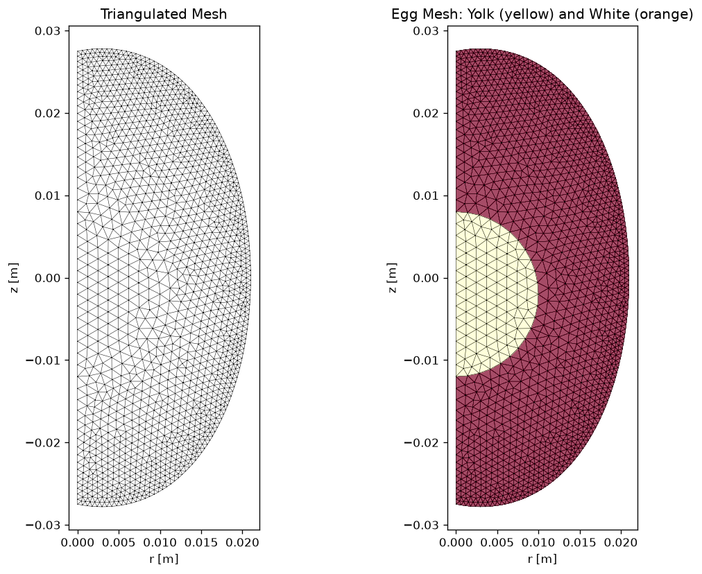
</p>

### Material Properties

| Property             | Egg White        | Egg Yolk         |
|----------------------|------------------|------------------|
| Density              | 1034–1040 kg/m³  | 1020–1030 kg/m³  |
| Thermal conductivity | 0.50–0.60 W/(m·K)| 0.32–0.36 W/(m·K)|
| Specific heat        | ~3800 J/(kg·K)   | ~3300 J/(kg·K)   |
| Denaturation enthalpy| ~2.0 kJ/kg (opt) | ~1.8 kJ/kg (opt) |
| Activation energy $E_a$ | 480 kJ/mol    | 250 kJ/mol       |

All properties vary with temperature (linear fits from experimental data). Optional presets (`egg_white_denaturation_properties`, `egg_yolk_denaturation_properties`) incorporate endothermic latent heat of protein denaturation via an apparent heat capacity Gaussian peak.

<p align="center">
  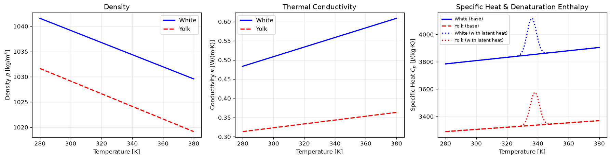
</p>

### Solver

- Backward Euler (implicit) time integration
- Lagged nonlinear coefficients (properties evaluated at $T^n$ to solve for $T^{n+1}$)
- Shell boundary condition: Dirichlet ($T = 100\,^\circ\text{C}$, `h_conv=None`) or convective Robin ($-\kappa \frac{\partial T}{\partial n} = h_{\text{conv}}(T - T_{\text{boundary}})$, e.g. `h_conv=H_BOILING_SHELL`), with natural symmetry at $r = 0$ and dynamic multi-stage BC updates (`set_boundary_conditions`)

## Simulation Results

### Temperature Field Evolution

Snapshots of the internal temperature distribution at 2-minute intervals with overlaid denaturation isotherms ($63\,^\circ\text{C}$, $65\,^\circ\text{C}$, and $70\,^\circ\text{C}$):

<p align="center">
  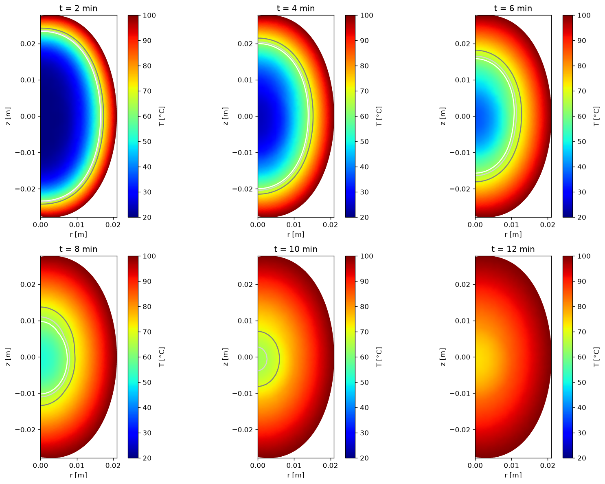
</p>

Spatial temperature distribution when the yolk center reaches the soft-, medium-, and hard-boiled thresholds:

<p align="center">
  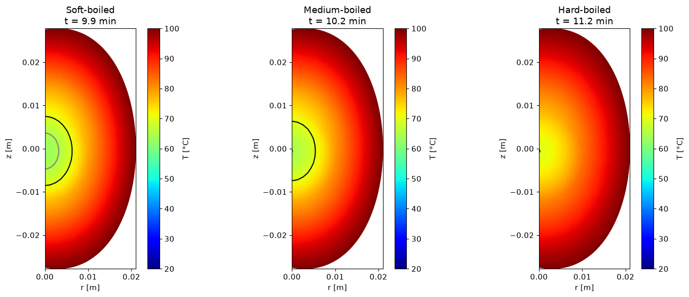
</p>

### Parameter Studies

#### 1. Room Temperature ($20\,^\circ\text{C}$) vs. Refrigerated ($8\,^\circ\text{C}$)

<p align="center">
  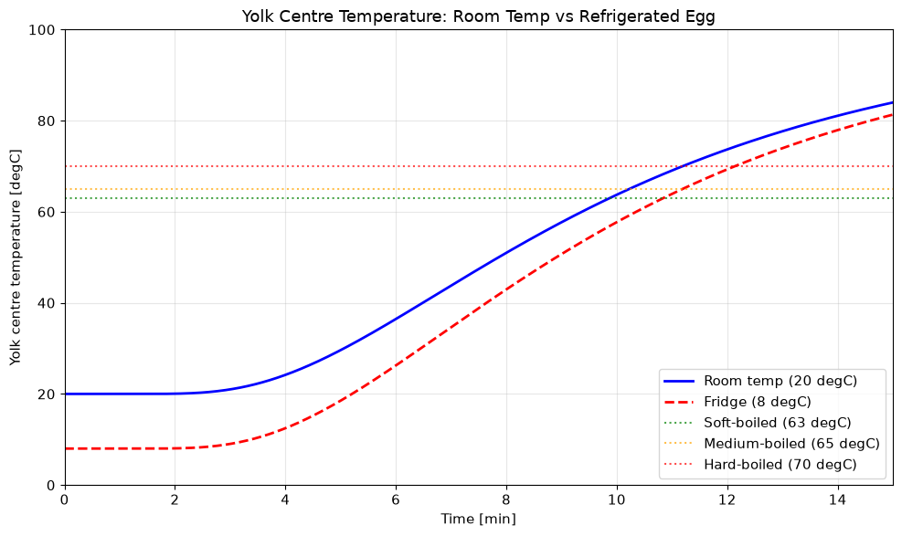
</p>

#### 2. Effect of Egg Size (Small, Medium, Large)

<p align="center">
  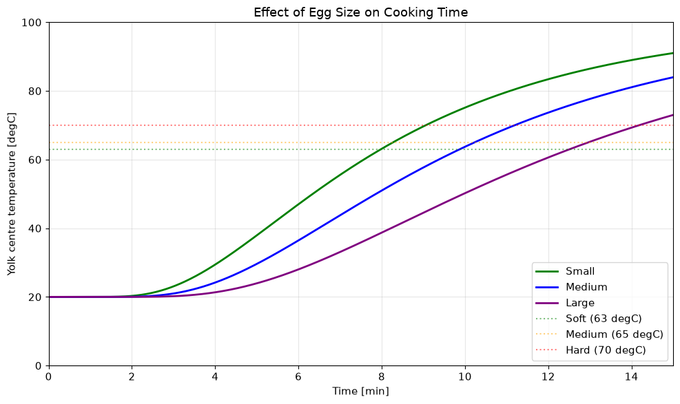
</p>

#### 3. Convective Shell Resistance (Robin BC) & Denaturation Latent Heat

<p align="center">
  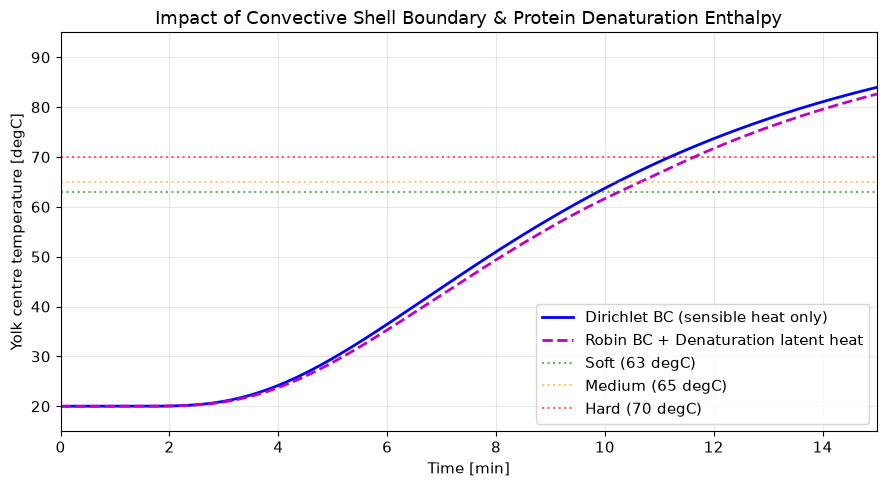
</p>

### Summary of Predicted Cooking Times (Medium Egg, $55\text{ mm} \times 42\text{ mm}$)

| Cooking Stage | Room Temp ($20\,^\circ\text{C}$, Dirichlet) | Fridge ($8\,^\circ\text{C}$, Dirichlet) | Room Temp (Robin BC + Latent Heat) |
|---------------|---------------------------------------------|-----------------------------------------|------------------------------------|
| **Soft-boiled** ($63\,^\circ\text{C}$ center)   | 9.9 min (592 s)  | 10.8 min (651 s) | 10.3 min (615 s) |
| **Medium-boiled** ($65\,^\circ\text{C}$ center) | 10.2 min (614 s) | 11.2 min (671 s) | 10.7 min (640 s) |
| **Hard-boiled** ($70\,^\circ\text{C}$ center)   | 11.2 min (672 s) | 12.1 min (728 s) | 11.6 min (699 s) |

---

### Arrhenius Denaturation Kinetics (`04_arrhenius_kinetics.ipynb`)

#### 1. Arrhenius Rate Curves & Kinetic Crossover ($64.5\,^\circ\text{C}$)

<p align="center">
  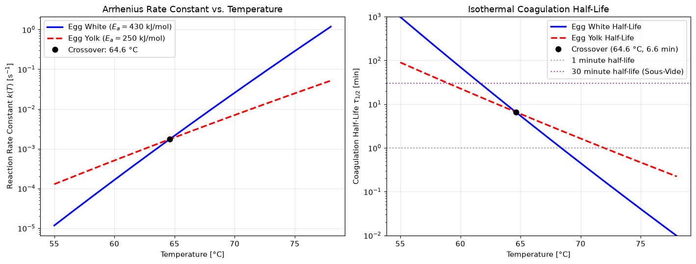
</p>

#### 2. Coagulation Progression & Soft-Boiled Perfection Index

<p align="center">
  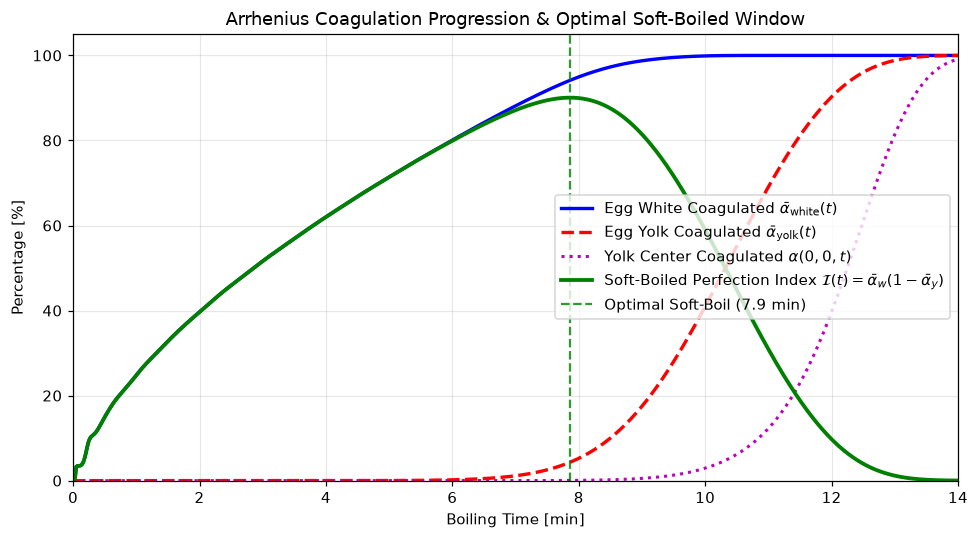
</p>

<p align="center">
  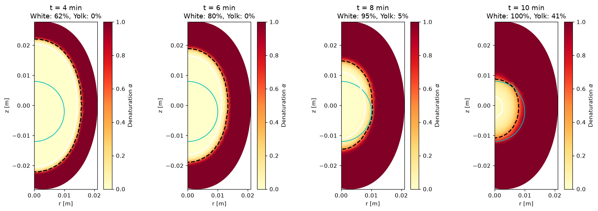
</p>

#### 3. Carryover Cooking vs. Ice-Bath Quenching

<p align="center">
  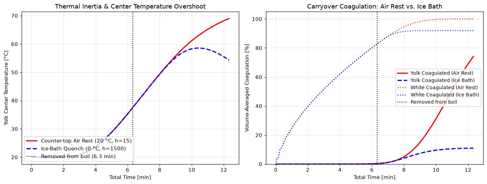
</p>

#### 4. Sous-Vide / Onsen Tamago ($63.5\,^\circ\text{C}$, 45 min)

<p align="center">
  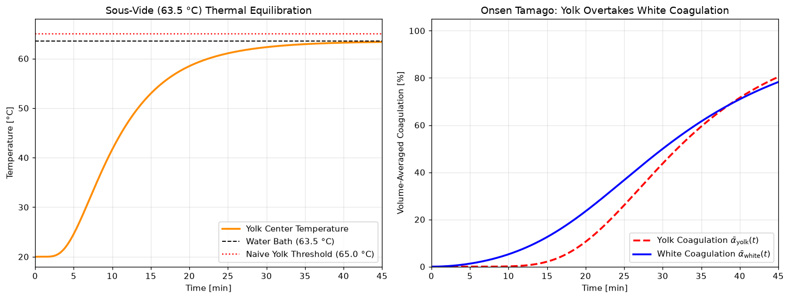
</p>

## License

[MIT](LICENSE)
