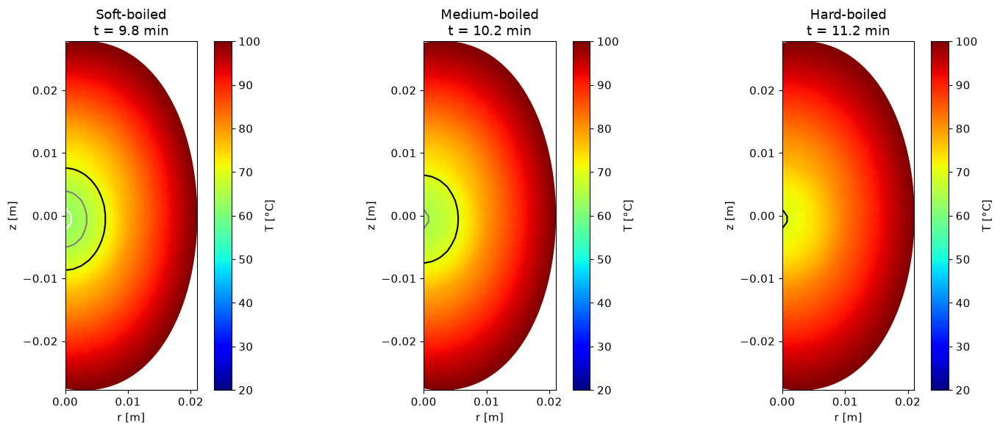
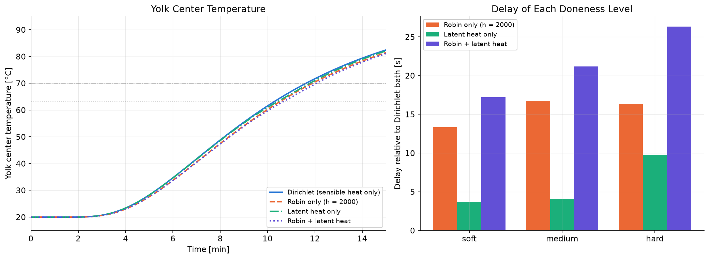
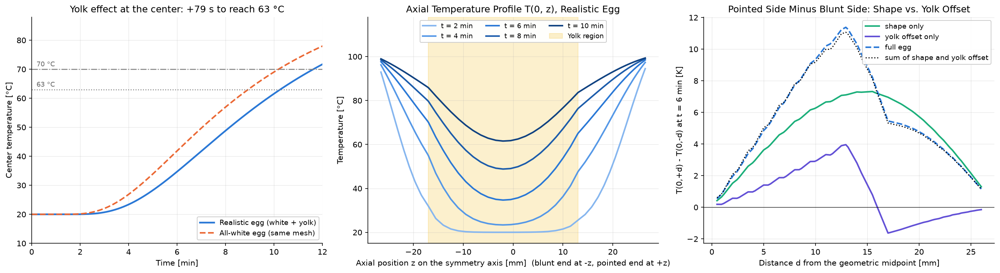
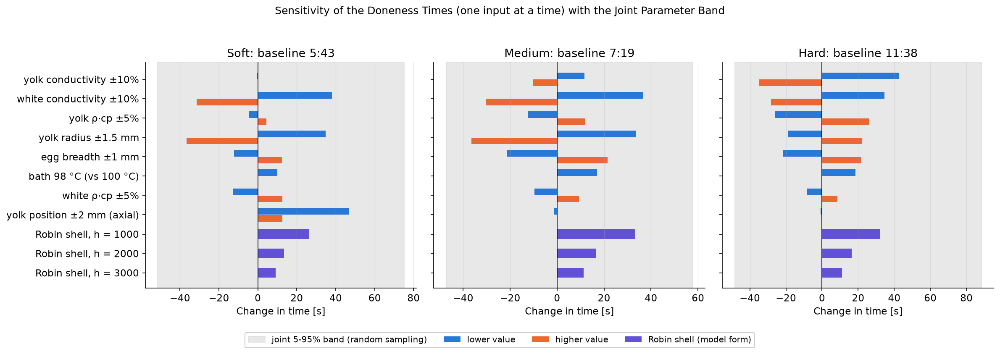
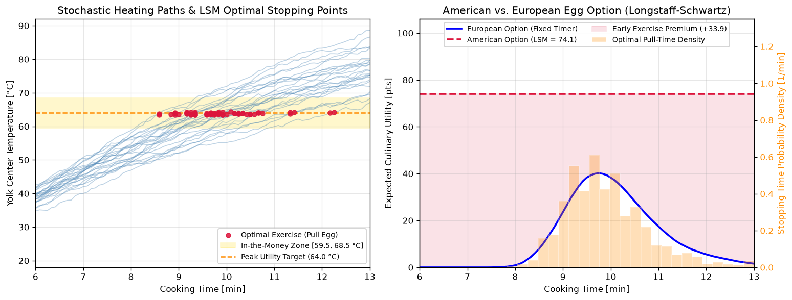

# How Long to Boil an Egg? FEM Modeling with Python

A finite element simulation of heat transfer during egg boiling, solving the axisymmetric transient heat equation in cylindrical coordinates $(r, z)$:

$$
\rho(T) C_p(T) \frac{\partial T}{\partial t} = \frac{1}{r} \frac{\partial}{\partial r}\left(r \kappa(T) \frac{\partial T}{\partial r}\right) + \frac{\partial}{\partial z}\left(\kappa(T) \frac{\partial T}{\partial z}\right)
$$

Built with [scikit-fem](https://github.com/kinnala/scikit-fem) and [gmsh](https://gmsh.info/), this project models the temperature evolution inside an egg immersed in boiling water and reports the time at which it reaches soft-, medium-, and hard-boiled doneness. A second part, [`egg_fem/options.py`](egg_fem/options.py), borrows the vocabulary of derivatives pricing (a corridor option and an optimal stopping problem) for the same egg.

**At a glance**

- For the default egg (55 x 42 mm, about 58 g, started at 20 °C in a 100 °C bath) the model gives soft 5:43, medium 7:19 and hard 11:38 (min:sec). The definitions behind these words are stated [below](#doneness-definitions).
- The solver is verified against the exact series solution for a homogeneous sphere (maximum center error 0.051 K). It has **not** been compared with measured egg temperatures.
- Numerical error for the default mesh and time step is about 1 s. Plausible uncertainty in the material properties (±10% conductivity, ±5% heat capacity around the repository's fitted values), geometry, yolk position and bath puts the 5-95% band at roughly 50 s earlier to 60-90 s later than the baseline. The band does not cover a literature-style alternative property set (set B in notebook 02 moves the medium and hard times by -65 and -143 s), and unmodeled physics could add more.
- The soft time is a single-point criterion (the coldest point of the white) and moves by about 25 s per mm of axial yolk displacement, which the model does not know; the medium and hard times move by a few seconds at most.

## Reference

This project is a Python re-implementation inspired by the Wolfram Language blog post:

> **How Long to Boil an Egg? FEM Modeling with Wolfram Language**
> Wolfram Blog, September 15, 2025
> https://blog.wolfram.com/2025/09/15/how-long-to-boil-an-egg-fem-modeling-with-wolfram-language/

It is not a reproduction of that post. This project uses its own egg size and shape (a 55 x 42 mm Hügelschäffer profile), its own fitted material property data (described below) and its own doneness definitions. Its times are therefore not expected to match the post's, and no attempt was made to reproduce the post's numbers.

## Setup

All commands are run from the repository root. Python 3.9 or newer is required. The reference results in this README were produced with Python 3.12, numpy 2.5, scipy 1.18, scikit-fem 12.0.2 and gmsh 4.15. The doneness times of the default egg also come out identical to the printed digit (343.3, 438.8 and 697.6 s) with the oldest stack the package allows (Python 3.9, numpy 1.24, scipy 1.10, scikit-fem 9.0, gmsh 4.11).

### With pip

```bash
python -m venv .venv
source .venv/bin/activate          # or .venv\Scripts\activate on Windows
pip install -e ".[dev,notebooks]"  # egg_fem (editable) + pytest + JupyterLab, nbconvert, ipykernel
```

`pip install -r requirements.txt` is the runtime-only alternative: it installs the dependencies and, through its last line (`-e .`), the package itself in editable mode. It also has to be run from the repository root, and it does not install pytest or Jupyter.

### With conda

```bash
conda env create -f environment.yml
conda activate fem-boil-egg
```

`environment.yml` installs `egg_fem` in editable mode through a `-e .` pip entry, so keep it in the repository root. It does not pin Python (`python>=3.9`), so conda picks the newest interpreter it can; pin one (for example `python=3.12`) if you want the interpreter used for the numbers here.

On Linux, the gmsh pip wheel needs a few system libraries even though gmsh runs headless here: `sudo apt-get install -y libglu1-mesa libxcursor1 libxft2 libxinerama1 libxrender1`.

### Run the tests

```bash
python -m pytest
```

The suite has 155 tests and takes about 15 s. One test (building meshes off the main thread) needs gmsh 4.12 or newer and is skipped on older gmsh versions.

### Run the notebooks

```bash
jupyter lab notebooks/
```

Or execute one headless, from the `notebooks/` directory (the notebooks write their figures to `../figures/`):

```bash
cd notebooks
jupyter nbconvert --to notebook --execute --inplace 01_simple_model.ipynb
```

Notebooks 01 and 02 take about half a minute each and notebook 04 about two minutes (it runs 15 extra FEM simulations and several large Monte Carlo studies); notebook 03 takes 8 to 10 minutes because of its Monte Carlo study.

### Continuous integration

[`.github/workflows/tests.yml`](.github/workflows/tests.yml) runs on every push and pull request. One job runs the test suite on Python 3.9 and 3.12 with the newest dependencies and on Python 3.9 with the oldest versions that `pyproject.toml` allows ([`.github/constraints-oldest.txt`](.github/constraints-oldest.txt), the same stack as the old-stack numbers above). A second job installs the notebook extras and executes all four notebooks top to bottom on Python 3.12, writing the executed copies to a temporary directory so that the committed notebooks are not modified; a notebook that no longer runs fails the build.

### A minimal example

```python
from egg_fem import (T_BOILING, T_ROOM, HeatSolver, create_egg_mesh,
                     doneness_times, egg_white_properties, egg_yolk_properties)

mesh = create_egg_mesh()                      # 55 x 42 mm egg, 15 mm yolk
materials = {"white": egg_white_properties, "yolk": egg_yolk_properties}
solver = HeatSolver(mesh, materials, T_init=T_ROOM, T_boundary=T_BOILING, dt=1.0)
solver.run(900, progress=False)               # 15 min of boiling
print({k: round(v, 1) for k, v in doneness_times(solver).items()})
# {'soft': 343.3, 'medium': 438.8, 'hard': 697.6}   (seconds)
```

## Project Structure

```
fem_boil_egg/
├── pyproject.toml                # Package metadata, dependency floors, pytest settings, extras
├── environment.yml               # Conda environment (installs egg_fem editable)
├── requirements.txt              # pip dependencies (installs egg_fem editable)
├── .github/
│   ├── constraints-oldest.txt    # Oldest allowed dependency versions, used by one CI leg
│   └── workflows/
│       └── tests.yml             # CI: pytest (newest and oldest dependencies), plus notebook execution
├── egg_fem/                      # Core Python package
│   ├── __init__.py
│   ├── materials.py              # Temperature-dependent & latent-heat material properties
│   ├── geometry.py               # Hügelschäffer egg profile, meshes (circular + egg), mesh_volume
│   ├── solver.py                 # Axisymmetric FEM heat solver (Dirichlet & Robin BCs) and probes
│   ├── doneness.py               # Soft / medium / hard doneness definitions and crossing times
│   └── options.py                # Black-Scholes heat FEM, FEM-driven egg thermal response,
│                                 #   corridor option and American (LSM) option
├── figures/                      # Plots written by the notebooks, used in this README
├── tests/
│   ├── test_fem.py               # Geometry, materials, solver (sphere benchmark) and doneness tests
│   └── test_options.py           # Black-Scholes, similarity scaling, corridor and LSM tests
└── notebooks/
    ├── 01_simple_model.ipynb        # Sphere, exact Fourier series, convergence study
    ├── 02_realistic_model.ipynb     # Egg shape, yolk, materials, yolk effect, axial asymmetry
    ├── 03_cooking_analysis.ipynb    # Doneness times, fridge vs room, sizes, sensitivity band
    └── 04_options_pricing_on_an_egg.ipynb # Black-Scholes heat FEM, corridor & American egg options
```

## Notebooks

### 1. [Simple Model](notebooks/01_simple_model.ipynb)

Introduces the axisymmetric FEM approach on a semicircular cross-section with constant material properties and benchmarks it against the exact Fourier-series solution for a homogeneous sphere, including a mesh and time-step convergence study and the start-up behavior of the consistent mass matrix.

### 2. [Realistic Model](notebooks/02_realistic_model.ipynb)

Adds the Hügelschäffer egg outline, separate yolk and white regions with distinct temperature-dependent properties, and mesh refinement near the shell. It then measures two things instead of asserting them: how much the yolk changes the cooking time (and why), and how much faster the pointed end heats than the blunt end (and why).

### 3. [Cooking Analysis](notebooks/03_cooking_analysis.ipynb)

Defines the doneness levels and uses the model to compare:
- Room temperature (20 °C) vs. refrigerated (8 °C) eggs
- Convective shell heat transfer (Robin BC) and endothermic protein denaturation enthalpy
- Five egg sizes
- A sensitivity study and a joint Monte Carlo band for the uncertainty of the predicted times

### 4. [Options Pricing on an Egg](notebooks/04_options_pricing_on_an_egg.ipynb)

Connects heat transfer to derivatives pricing: the Black-Scholes / heat equation duality, a FEM-driven thermal underlying, a corridor "Soft-Boil Warranty" option, an American "When to Pull the Egg" option, and a check of the prices against an underlying tabulated from direct FEM runs. See [Quantitative Finance on the Stove](#quantitative-finance-on-the-stove-options-pricing-on-an-egg) below.

## Model Details

### Geometry & Mesh

The egg is an axisymmetric body in the $(r, z)$ half-plane. The shell outline is the Hügelschäffer egg curve

$$
r(z) = \frac{B}{2}\sqrt{\frac{L^2 - 4z^2}{L^2 + 8wz + 4w^2}}, \qquad -\frac{L}{2} \le z \le \frac{L}{2}, \qquad w = aL
$$

with pole-to-pole length L = 55 mm, maximum breadth B = 42 mm and asymmetry a = 0.06. The pole-to-pole length and the maximum breadth are exact, and z is strictly monotone along the profile (no dimples at the poles). The **pointed end is at the top** (+z) and the blunt end at the bottom (-z); the widest cross-section sits at z = -3.3 mm, toward the blunt end. The radius is 13.2 mm at z = +20 mm and 15.7 mm at z = -20 mm. For a = 0 the curve is an ellipse.

- **Outline in gmsh.** The outline is a gmsh interpolating (Catmull-Rom) spline through 60 points of the exact profile, not a B-spline.
- **Volume.** The revolved profile has a volume of 50.65 mL (the ellipsoid with the same length and breadth has 50.80 mL).
- **Yolk.** The yolk is a sphere (a circle in the half-plane) of radius 15 mm, centered 2 mm below the geometric midpoint toward the blunt end. On the mesh it has a volume of 14.10 mL, which is 27.8% of the egg (the white has 36.54 mL); real hen eggs are about 26-31%. `create_egg_mesh` raises a `ValueError` if the yolk does not fit inside the shell with a positive white thickness; for the default egg the thinnest white layer is 5.95 mm.
- **Mesh.** Triangles of 1.5 mm in the interior, refined to 0.6 mm along the shell outline. The default egg mesh has 1154 nodes and 2132 elements. `mesh_volume` integrates the true (axisymmetric) volume of a mesh or one of its subdomains.

<p align="center">
  
</p>

### Material Properties

White and yolk have temperature-dependent linear fits for density, thermal conductivity and specific heat. The ranges below are what the code evaluates between 20 °C and 100 °C:

| Property (20 to 100 °C) | Egg White | Egg Yolk |
|---|---|---|
| Density | 1030.4 to 1040 kg/m³ | 1020 to 1030 kg/m³ |
| Thermal conductivity | 0.50 to 0.60 W/(m·K) | 0.32 to 0.36 W/(m·K) |
| Specific heat | 3800 to 3896 J/(kg·K) | 3300 to 3364 J/(kg·K) |
| Volumetric heat capacity ρ·Cp | 3.95 to 4.01 MJ/(m³·K) | 3.40 to 3.43 MJ/(m³·K) |
| Thermal diffusivity | 1.27 to 1.50 × 10⁻⁷ m²/s | 0.94 to 1.05 × 10⁻⁷ m²/s |
| Denaturation enthalpy (optional preset) | 2.0 kJ/kg, Gaussian peak at 63 °C | 1.8 kJ/kg, Gaussian peak at 65 °C |

At 20 °C the yolk has 0.64 times the conductivity, 0.86 times the volumetric heat capacity and 0.74 times the diffusivity of the white.

**Provenance and caveats.** The linear fits are representative values chosen to match the range of published data for liquid egg white and yolk; they are not coefficients copied from a single paper. The data that informed them are:
- Coimbra, J. S. R., Gabas, A. L., Minim, L. A., Garcia Rojas, E. E., Telis, V. R. N., Telis-Romero, J. (2006). Density, heat capacity and thermal conductivity of liquid egg products. *Journal of Food Engineering* 74(2), 186-190 (measured between 0 and 38 °C).
- Denys, S., Pieters, J. G., Dewettinck, K. (2004). Computational fluid dynamics analysis of combined conductive and convective heat transfer in model eggs. *Journal of Food Engineering* 63(3), 281-290.

**Above 38 °C the fits are extrapolated beyond the measured range**, and they describe raw (liquid) egg although they are applied after the proteins have set. The yolk-versus-white comparisons below depend on these numbers.

The optional latent-heat presets (`egg_white_denaturation_properties`, `egg_yolk_denaturation_properties`) add the endothermic enthalpy of protein denaturation as a Gaussian peak (standard deviation 3 K) in the apparent heat capacity; at the peak it adds about 266 J/(kg·K) for the white and 239 J/(kg·K) for the yolk. The effective shell heat transfer coefficient for the Robin condition, `H_BOILING_SHELL = 2000` W/(m²·K), is an assumed value that lumps the shell and the boiling-water film; the sensitivity study varies it from 1000 to 3000.

<p align="center">
  
</p>

### Solver

- P1 (linear triangle) finite elements in scikit-fem on the axisymmetric weak form (every integral carries the weight r), with a consistent (non-lumped) mass matrix and a sparse direct solve
- Backward Euler (implicit) time integration, 1 s steps in all results here
- Lagged nonlinear coefficients (properties evaluated at the previous step's temperature to solve for the next)
- Shell boundary condition: Dirichlet (T = 100 °C on the shell from t = 0, `h_conv=None`) or convective Robin (`-κ ∂T/∂n = h_conv (T - T_boundary)`, e.g. `h_conv=H_BOILING_SHELL`); natural symmetry condition at r = 0
- **Initial-condition convention.** With a Dirichlet shell the shell nodes already start at 100 °C and every other node at the initial temperature (a compatible initial state). With a Robin shell the whole field starts at the initial temperature. The two conventions differ only at the discretization level: at 300 s the center temperature of a Dirichlet run exceeds that of a Robin run with a huge coefficient (h = 10⁸ W/(m²·K)) by 1.000, 0.240 and 0.062 K on the 3, 1.5 and 0.75 mm sphere meshes, so they converge as the mesh is refined.
- **Start-up undershoot.** The consistent mass matrix lets the solution dip slightly below the initial temperature next to the shell in the first steps (by up to 1.37 K on the 1.5 mm sphere mesh of notebook 01, gone within about 24 s; 0.03 K for the default egg mesh). It shrinks with mesh and time-step refinement and has a small effect on the heating curve.
- Diagnostics on the solver: P1-interpolated temperature at the yolk center, the coldest temperature in a region (exact for P1 fields), and the true (r-weighted) volume fraction of a region above a threshold (16-point quadrature per triangle)

### Doneness Definitions

"Soft-boiled" and "hard-boiled" are not temperatures of a single point. `egg_fem/doneness.py` defines three levels from the temperature field of the white and the yolk, evaluated on a finished simulation:

| Level | Definition | Physical picture |
|---|---|---|
| **soft** | the coldest point of the *white* reaches 63 °C | white set everywhere, yolk runny |
| **medium** (jammy) | at least 50% of the *yolk volume* is at or above 70 °C | outer yolk set, center still soft |
| **hard** | the coldest point of the *yolk* reaches 70 °C | yolk set throughout |

**Motivation.** These are modeling choices motivated by protein set points: egg white starts to set near 63 °C (ovotransferrin denatures near 62-63 °C) and the yolk sets near 70 °C. The soft criterion is the one behind C. D. H. Williams' egg-timing formula, in which an egg "will be ready when the temperature at the boundary of the yolk has risen to" about 63 °C ([The science of boiling an egg](https://www.exeter.ac.uk/research-centres/theoretical-physics/boiling-an-egg/), University of Exeter). Williams applies it to a homogeneous sphere; here it is applied to the coldest point of the yolk boundary. For the default egg, the coldest point of the white lies on the white-yolk interface (on the symmetry axis at the top of the yolk, which notebook 02 prints), so at the soft time even the coolest part of the yolk surface is at 63 °C. That was checked for the default egg only.

**The soft level is a single-point criterion.** The coldest white point is the top or the bottom of the yolk on the symmetry axis, so the soft time depends on where the yolk sits, which the model does not know. Over yolk-center positions from z = -5 to +2 mm the soft time spans 327 to 412 s, with a kink where the coldest point switches from the top to the bottom of the yolk, while the medium and hard times move by at most 4.2 s and 2.2 s (scan in [How Uncertain Are These Times?](#how-uncertain-are-these-times)).

The yolk-center crossing times (63, 65 and 70 °C at the center) are reported as a secondary diagnostic; the yolk center is the coldest point of the yolk for the default egg, so its 70 °C crossing coincides with the hard time.

The 50% yolk fraction for medium is a convention, not a measured texture endpoint. **These definitions are not measured doneness data.** Agreement of the resulting times with cooking guides, shown below, is a consistency check on definitions chosen to match those descriptions. It is not an independent test of the model.

### Assumptions

None of these has been checked against measured egg temperatures.

- **Constant bath from t = 0.** The shell is held at 100 °C instantly (Dirichlet) or heated through a film with a constant coefficient (Robin). A real pot cools when a cold egg is added and then recovers.
- **Sea level.** Water boils at 100 °C only at sea level; at altitude the bath is cooler and times are longer.
- **Shell resistance only in the Robin case.** The Dirichlet runs ignore the shell and the water-side film; in the Robin runs one assumed coefficient lumps them.
- **No air cell** at the blunt end and no gap between the shell membrane and the white.
- **Heat conduction only.** No convection inside the white or yolk, no water loss, no shrinkage.
- **Raw-egg properties after coagulation.** Linear fits to data for liquid egg measured below about 38 °C, extrapolated to 100 °C (see above).
- **Spherical yolk at a fixed position.** The yolk is a sphere 2 mm below the midpoint, about 28% of the volume; real yolks vary and drift toward the shell. The soft time moves by 23 to 27 s per mm of axial displacement (see [How Uncertain Are These Times?](#how-uncertain-are-these-times)).
- **Axisymmetric egg.** Real eggs are only approximately bodies of revolution.
- **Uniform start.** The egg starts at one uniform temperature (20 °C or 8 °C).
- **Doneness levels are modeling choices** (see above), not measured texture endpoints.

## Simulation Results

### Verification Against an Exact Solution

Notebook 01 compares the solver with the exact Fourier-Bessel series for a homogeneous sphere (radius 22 mm, constant white properties, thermal diffusivity 1.394 × 10⁻⁷ m²/s, 20 °C start, 100 °C shell; 469 nodes, 1.5 mm elements, 1 s steps). Over 0 to 720 s the center temperature agrees to 0.051 K at most (0.035 K RMS), and the 63 °C crossing is at 509.98 s against 510.42 s exactly (-0.44 s). The convergence study varies the element size (3, 1.5 and 0.75 mm) and the time step (2, 1 and 0.5 s):

- The temporal order is 1.00 on all three meshes (backward Euler is first order): the 63 °C crossing shifts by 0.6 s when the step goes from 2 s to 1 s and by 0.3 s from 1 s to 0.5 s.
- The spatial error of the 63 °C crossing, extrapolated to a zero time step, is -7.4 s, -1.05 s and -0.38 s for 3, 1.5 and 0.75 mm elements. The observed spatial order is 2.83 from 3 to 1.5 mm and 1.46 from 1.5 to 0.75 mm, so it is not a clean second-order sequence.
- At 1.5 mm and 1 s the spatial and temporal errors partly cancel, so the small -0.44 s is not the whole story; on the 3 mm mesh the crossing is off by about 7 s.

The benchmark covers the heat solver on a homogeneous sphere. The egg itself (two regions, temperature-dependent properties) has no exact solution; for it, halving the element size and the time step changes the soft, medium and hard times by only -1.0, 0.0 and -1.2 s.

### Doneness Times

The default egg (55 x 42 mm, 15 mm yolk, about 58 g) started at 20 °C in a 100 °C bath, 1 s time steps (minutes in decimals and as min:sec):

| Doneness | Room 20 °C, Dirichlet | Fridge 8 °C, Dirichlet | Room 20 °C, Robin (h = 2000) + latent heat | Illustrative guide value |
|---|---|---|---|---|
| **Soft** (coldest white point at 63 °C) | 343 s, 5.7 min (5:43) | 388 s, 6.5 min (6:28) | 361 s, 6.0 min (6:01) | about 6 min (runny) |
| **Medium** (50% of yolk at 70 °C) | 439 s, 7.3 min (7:19) | 493 s, 8.2 min (8:13) | 460 s, 7.7 min (7:40) | 7-8 min (jammy) |
| **Hard** (coldest yolk point at 70 °C) | 698 s, 11.6 min (11:38) | 756 s, 12.6 min (12:36) | 724 s, 12.1 min (12:04) | 10-12 min |

The guide values are illustrative round numbers of the kind found in popular cooking guides for a large egg lowered into boiling water. They are not taken from specific cited sources and are not a controlled dataset, and guides rarely state start temperature, pot size or egg size. The room-temperature egg is 17 s early for "about 6 min" and inside the other two ranges. The refrigerated egg runs 28, 13 and 36 s past 6 min, 8 min and 12 min, which is a bracket rather than a contradiction. This agreement is the consistency check described above; the definitions were chosen to correspond to those descriptions. For the medium level it carries almost no information: for the room-temperature egg the share of the yolk volume at or above 70 °C is 45% after 7 minutes and 61% after 8, so any medium fraction between about 45% and 61% would land inside the 7-8 minute range, and the 50% convention is not tested by the guide.

### Center-Temperature Diagnostics

The yolk center is a poor stand-in for "soft": its 63, 65 and 70 °C crossings fall within about 80 s of one another, so they cannot express the several-minute spread between a runny and a hard-boiled egg.

| Yolk center reaches | Room 20 °C, Dirichlet | Fridge 8 °C, Dirichlet | Room 20 °C, Robin + latent heat |
|---|---|---|---|
| 63 °C | 615 s (10:15) | 675 s (11:15) | 638 s (10:38) |
| 65 °C | 637 s (10:37) | 697 s (11:37) | 663 s (11:03) |
| 70 °C | 698 s (11:38) | 756 s (12:36) | 724 s (12:04) |

The state of the room-temperature egg at each doneness time shows what the levels mean in temperature terms:

| At the time of | Yolk center | Coldest white point | Yolk volume at or above 63 °C | Yolk volume at or above 70 °C |
|---|---|---|---|---|
| soft (5:43) | 32.8 °C | 63.0 °C | 44% | 24% |
| medium (7:19) | 44.0 °C | 73.0 °C | 70% | 50% |
| hard (11:38) | 70.0 °C | 87.7 °C | 100% | 100% |

For the room-temperature egg, the yolk center is at 34.7, 41.7 and 48.8 °C after 6, 7 and 8 minutes, the coldest white point at 65.0, 71.3 and 76.3 °C, the share of the yolk volume at or above 63 °C rises from 49% to 66% to 80%, and the share at or above 70 °C from 28% to 45% to 61%. What changes between 6 and 8 minutes is the outer yolk, not the center.

By temperature alone the yolk is already partly set at the soft time (its outer 44% is above 63 °C) around a core at only 33 °C. The model tracks temperature only, so whether such a yolk reads as "runny" depends on a texture endpoint it does not contain.

### Temperature Field Evolution

Snapshots of the temperature field at 2-minute intervals with the 63 °C and 70 °C isotherms overlaid, and the field at the moments the egg reaches each doneness level (the cyan line is the 63 °C isotherm, the white line the 70 °C isotherm, the dashed line the yolk outline):

<p align="center">
  
</p>

<p align="center">
  
</p>

At the soft time the 63 °C isotherm is pinched against the top of the yolk on the symmetry axis (the coldest white node is on the axis at z = 13.0 mm, on the yolk surface). Notebook 02 also tracks the fronts along the line through the yolk center: the 63 °C front reaches the yolk surface at 158 s and the yolk center at 616 s, the 70 °C front 206 s and 698 s.

### Room Temperature vs. Refrigerated

<p align="center">
  
</p>

The refrigerated egg is later by 45 s (soft), 54 s (medium) and 58 s (hard), about a minute, although the starting temperatures differ by 12 K. In the late, nearly exponential approach to the bath temperature the center follows `T_bath - T` proportional to `exp(-t/τ)` with τ = 393 s, so the larger initial offset (92 instead of 80 K) delays every late crossing by about τ ln(92/80) = 55 s. The soft level, set by the white that is heated early, shows the smallest lag.

### Shell Resistance (Robin BC) and Denaturation Latent Heat

<p align="center">
  
</p>

Relative to the idealized Dirichlet bath, a Robin shell with h = 2000 W/(m²·K) delays the soft, medium and hard times by 13.3, 16.7 and 16.3 s. The latent heat of denaturation alone adds 3.7, 4.1 and 9.8 s; together the two effects add 17.2, 21.2 and 26.3 s. Across h = 1000 to 3000 the Robin shift is 9 to 33 s.

### The Role of the Yolk

The yolk is often described as a thermal insulator. In this model that is only part of the story. With the repository's property fits the yolk delays the time at which its own center reaches 63 °C by **79.5 s** compared with an all-white egg of the same shape, and the hard time by 86.2 s. The medium time changes by only +8.3 s, and the soft time is reached **13.9 s earlier** with a yolk than without. Soft is set by the coldest white point, which sits on the yolk surface, and the mechanism split below attributes the early soft time to the yolk's low heat capacity (alone it makes the soft time 17.0 s earlier, while its low conductivity alone changes it by +0.3 s).

Two mechanisms with opposite signs make up the net effect on the yolk-center 63 °C time (the all-white and single-mechanism variants run on the same mesh): the yolk's lower conductivity alone would add 155.4 s, its lower volumetric heat capacity alone would subtract 54.9 s, and an interaction term of -21.1 s remains (net +79.5 s).

**The size, and even the sign, of the effect depend on the property data.** With an alternative property set B (diffusivity of the yolk 0.94 times that of the white instead of 0.74) the yolk changes the center 63 °C time by only -2.1 s and the hard time by -4.9 s. The constants of set B were transcribed from a secondary summary of a published paper and were not checked against the original, so set B is an illustration of the sensitivity, not a competing measurement. The 80 s delay should be read as a property of this repository's fitted values, with an uncertainty of the order of the effect itself.

<p align="center">
  
</p>

### Pointed End vs. Blunt End

Along the symmetry axis the pointed side is hotter than the blunt side at the same distance d from the geometric midpoint. After 6 minutes the difference T(0, +d) - T(0, -d) of the full egg is +3.7, +7.7, +10.8 and +7.3 K at d = 4, 8, 12 and 16 mm, and the axis point 8 mm toward the pointed end reaches 63 °C 71.7 s earlier than the one 8 mm toward the blunt end (491.9 s against 563.6 s). Separating the two causes:

- **The shape explains most of it.** An all-white egg with the same outline shows +2.8, +5.4, +6.9 and +7.2 K; the narrower pointed end has less volume per unit of shell area to heat. That is 64% to 76% of the full-egg difference at d = 4 to 12 mm.
- **The yolk offset adds the rest.** A symmetric ellipsoid with the yolk 2 mm toward the blunt end shows +1.0, +2.4, +3.6 and -0.04 K. The two separate effects add up to within 0.31 K of the full egg at 6 minutes.
- **The numerics add no asymmetry.** A control (ellipsoid, all white) gives differences of at most 0.1 K.

### Effect of Egg Size

Eggs of different weight classes have similar shapes, so length and breadth are scaled together and the yolk radius and offset are scaled with the breadth (yolk radius = 15 mm × B / 42 mm), keeping the yolk at 27.5% to 27.8% of the volume. Mass is a model estimate, volume × 1.035 g/mL plus 6 g of shell; the US and EU classes are the approximate weight classes of those grading schemes, shown to relate the model sizes to what is sold.

| Egg (L x B) | Volume | Est. mass | US / EU class | Soft | Medium | Hard |
|---|---|---|---|---|---|---|
| 50 x 38 mm | 37.7 mL | 45.0 g | Small / S | 4:43 | 6:01 | 9:32 |
| 53 x 40 mm | 44.3 mL | 51.8 g | Medium / S | 5:17 | 6:42 | 10:36 |
| 55 x 42 mm | 50.6 mL | 58.4 g | Large / M | 5:43 | 7:19 | 11:38 |
| 58 x 44 mm | 58.6 mL | 66.7 g | XL / L | 6:20 | 8:04 | 12:47 |
| 61 x 46 mm | 67.4 mL | 75.7 g | Jumbo / XL | 6:59 | 8:51 | 14:01 |

<p align="center">
  
</p>

From the smallest to the largest egg the soft time moves from 4:43 to 6:59 and the hard time from 9:32 to 14:01. The log-log slope of each doneness time against egg volume is 0.669, 0.666 and 0.664 (soft, medium, hard), close to the 2/3 expected for diffusive heating, where time scales with the square of a linear dimension.

### How Uncertain Are These Times?

Notebook 03 perturbs the inputs one at a time around the baseline (default egg, 20 °C start, 100 °C Dirichlet bath). The table gives the change in the soft / medium / hard time in seconds for the lower and the upper input value (for the yolk position, the lower value is the yolk center at z = -4 mm and the upper value at z = 0, around the default of -2 mm):

| Input | Lower value | Upper value |
|---|---|---|
| White conductivity ±10% | +38.1 / +36.4 / +34.5 | -31.5 / -30.2 / -28.4 |
| Yolk conductivity ±10% | -0.4 / +11.7 / +42.7 | +0.0 / -10.1 / -35.1 |
| White ρ·Cp ±5% | -12.7 / -9.6 / -8.6 | +12.6 / +9.3 / +8.6 |
| Yolk ρ·Cp ±5% | -4.5 / -12.6 / -26.2 | +4.4 / +12.1 / +26.2 |
| Yolk radius ±1.5 mm | +34.8 / +33.6 / -18.9 | -36.7 / -36.5 / +22.3 |
| Egg breadth ±1 mm (length fixed) | -12.1 / -21.4 / -21.4 | +12.4 / +21.5 / +21.5 |
| Yolk axial position ±2 mm | +46.6 / -1.2 / -0.8 | +12.5 / -0.1 / -0.3 |

The yolk-position row understates how much the soft time depends on it, because the soft time is not monotone in the position. The scan in notebook 03 moves the yolk center along the axis (positive z is toward the pointed end):

| Yolk center z (mm) | -5 | -4 | -3 | -2 (default) | -1.5 | -1 | 0 | +2 |
|---|---|---|---|---|---|---|---|---|
| Soft (s) | 411.8 | 389.9 | 367.2 | 343.3 | 331.1 | 326.8 | 355.8 | 408.2 |
| Medium (s) | 435.0 | 437.6 | 438.4 | 438.8 | 439.2 | 438.8 | 438.6 | 436.2 |
| Hard (s) | 695.5 | 696.8 | 696.9 | 697.6 | 697.7 | 697.4 | 697.3 | 695.9 |

The soft time falls by 22.8 s per mm as the yolk moves toward the pointed end from z = -5 to -2 mm, has its minimum near z = -1 mm, where the coldest white point switches from the top to the bottom of the yolk, and then rises by 27.0 s per mm. Over the scan the soft time spans 327 to 412 s, while the medium time moves by at most 4.2 s and the hard time by at most 2.2 s. The soft level, a single-point criterion, is the least robust of the three to the unmeasured yolk position.

Three more rows are one-sided. A 98 °C bath instead of 100 °C adds +10.0 / +17.1 / +18.4 s. A Robin shell instead of a Dirichlet shell adds +26.2 / +33.1 / +32.2 s at h = 1000, +13.3 / +16.7 / +16.3 s at h = 2000 and +9.0 / +11.3 / +11.0 s at h = 3000 W/(m²·K). The **numerical check**, halving the element size and the time step, changes the times by -1.0 / 0.0 / -1.2 s.

Drawing all eight inputs simultaneously and independently from their ranges (uniform, which is deliberately generous; 100 draws, seed 20261118) gives a joint band. The sample mean is 354 / 445 / 708 s against baselines of 343 / 439 / 698 s, the standard deviation is 38 / 33 / 44 s (the one-at-a-time effects predict 32 / 33 / 38 s if they add independently; the soft prediction is low because the soft time is not monotone in the yolk position), and the 5-95% band, rounded to 5 s, is:

| Level | Baseline | 5-95% band | Relative to baseline |
|---|---|---|---|
| Soft | 5:43 | 4:50 to 7:00 | about 50 s earlier, 75 s later |
| Medium | 7:19 | 6:30 to 8:15 | about 45 s earlier, 60 s later |
| Hard | 11:38 | 10:50 to 13:05 | about 50 s earlier, 90 s later |

With 100 draws each end of a band is uncertain by about 7 to 9 s. If the shell and film resistance is included (Robin, h = 1000 to 3000) every time shifts later by 9 to 33 s, so the upper ends extend to about 7:25, 8:50 and 13:38.

**The band is conditional on its ranges.** They are ±10% conductivity, ±5% heat capacity, ±1.5 mm yolk radius, ±1 mm breadth, ±2 mm yolk position and a bath up to 2 °C cool, all around this repository's fitted property values. The alternative property set B of notebook 02 gives soft, medium and hard times of 310.6, 373.9 and 554.9 s, that is 33, 65 and 143 s earlier than the baseline: the medium and hard values lie outside the band, and the hard value is below even the case in which every input is adverse at once (558 s). The band should be read as the effect of perturbing the fitted values, not as a confidence interval for the true cooking time.

**Modeling uncertainty is much larger than numerical error:** the numerical error is about 1 s, while the input uncertainty alone spans roughly 105 to 140 s from the 5th to the 95th percentile. Errors in the model structure (see Assumptions) are not in these bands and could be larger.

<p align="center">
  
</p>

## Quantitative Finance on the Stove: Options Pricing on an Egg

[`04_options_pricing_on_an_egg.ipynb`](notebooks/04_options_pricing_on_an_egg.ipynb) explores three models connected to egg heat diffusion. The egg is not a traded asset and nothing here is calibrated to a market or to cooking data: the "prices" are expected culinary payoffs under an assumed distribution of kitchens, undiscounted, and not no-arbitrage prices. The finance vocabulary is borrowed for the payoff structures.

### 1. Black-Scholes and the Heat Equation

The log-price and time-reversal transform turns the Black-Scholes PDE into the 1D heat equation, which is solved with `scikit-fem` P1 elements and backward Euler. For a European call (K = 100, T = 1 year, r = 0.05, sigma = 0.25; 401 nodes, 400 steps) the maximum nodal error against the exact formula is **0.00354 USD** on the 88 nodes with S in [50, 150] (at-the-money price 12.3325 against 12.3360 USD).

- **First order in time.** On a 3201-node mesh the error halves with every halving of the step (0.0379 USD at 25 steps down to 0.00121 USD at 800 steps; ratios of 1.98 to 2.00). On the 401-node mesh the spatial error takes over (0.0016 USD at 3200 steps, ratio to the previous row 1.12).
- **Unsafe at small volatility.** The transform multiplies the solution by an exponential factor that grows as the volatility shrinks. The maximum error is 0.00354, 0.00332, 0.00676 and 0.0647 USD for sigma = 0.25, 0.15, 0.10 and 0.06, and the solver raises a `ValueError` for sigma = 0.05 and below rather than return a wrong number. A narrower domain extends the usable range: sigma = 0.05 on x in [-0.5, 0.5] gives 0.0153 USD.

<p align="center">
  
</p>

### 2. A FEM-Driven Thermal Underlying

The Monte Carlo layers need the probe temperature of an egg in tens of thousands of kitchens. One reference FEM run of the default egg (20 °C egg, 100 °C Dirichlet bath) is condensed into the dimensionless response of a probe, `theta(t) = (T_probe(t) - T_bath) / (T_init - T_bath)`, stored in a `ThermalResponse` (`ThermalResponse.from_fem`). Other kitchens are obtained by similarity scaling, with s the linear size scale (every length multiplied by s):

$$
T(t;\, T_0, T_b, s) = T_b + (T_0 - T_b)\,\theta\!\left(t / s^2\right)
$$

- **Probe.** The default probe is `white_min`, the coldest temperature in the white. For the default egg that point is on the yolk surface (on the axis at z = 13.0 mm at the moments the probe reaches 63, 66.5 and 70 °C), so the probe is the temperature of the coldest point of the yolk surface, not of the yolk surface as a whole. It reaches 63 °C at 343.3 s and 70 °C at 406.7 s, while the yolk center (an alternative probe) takes 615.4 s and 697.6 s.
- **Accuracy.** Scaling with size is exact up to discretization. Scaling the starting and bath temperatures is exact only for constant material properties, so it is an approximation. Against direct FEM runs of five perturbed kitchens (`check_similarity_against_fem`), the scaled crossing times of the probe at 63, 66.5 and 70 °C differ by at most 4.4 s (about 1% of the crossing time; the largest case is an 8 °C egg in a 98.5 °C bath with s = 1.03), by 3.1 s for the 8 °C egg alone and by 0.7 to 0.9 s for a 98.5 °C bath alone, and by exactly 0.00 s for a size change alone. The largest temperature difference over a whole run is 0.66 °C. For the yolk-center probe in the combined kitchen the difference is 6.1 to 6.3 s (about 0.8%). The check covers the default egg geometry, a Dirichlet bath and these five kitchens only, and the scaled response is not defined beyond 1200 s divided by s².

  The errors are systematic, not random: cold eggs and cool baths come out early and warm eggs late, which shrinks the spread between kitchens, so they do not average out in the Monte Carlo layers and the Monte Carlo standard errors below do not include them. Notebook 04 (Section 5) repeats the pricing with a response tabulated from 15 direct FEM runs (starting temperatures 6 to 34 °C by bath temperatures 95 to 100 °C, interpolated linearly, with exact size scaling; it reproduces the five direct runs above to within 0.005 s). On 400,000 common kitchens the similarity-scaled underlying overstates the corridor price by 0.12 USD (8.860 against 8.743 USD at 378 s; the Monte Carlo standard error of one price on 20000 paths is 0.02 USD) and the value of the best fixed timer by 1.26 points (67.13 against 65.87), so it understates the value of information below by 1.27 points (31.01 against 32.28, about 4%). The values of the dynamic policies move by less than 0.03 points. The headline numbers in this README are the similarity-scaled ones.
- **Kitchen uncertainty.** Starting temperature N(20, 3.5²) °C; bath temperature 100 - |N(0, 1.2²)| °C (never above the sea-level boil); size scale N(1, 0.02²), a mass coefficient of variation of about 6%. These spreads are modeling choices, not measurements. A uniform spread within one carton grade (US Large 56.7 to 63.8 g, EU M 53 to 63 g) would be a mass coefficient of variation of 3.4% to 5.0%, a size spread of about 1.1% to 1.7%, so 0.02 is somewhat wider than one grade and far narrower than a mix of grades. A refrigerator start (8 °C) is 3.4 standard deviations below the mean of the starting-temperature model, so fridge eggs are outside it. The model also leaves out the egg-to-egg variation of the yolk position, to which the soft level is sensitive (see [How Uncertain Are These Times?](#how-uncertain-are-these-times)).

### 3. Corridor Digital Option: the "Soft-Boil Warranty"

A binary option pays 10 USD if the probe temperature at the pull time lies in the soft-boil corridor of 63 to 70 °C (the doneness window from `egg_fem.doneness`, a modeling choice). The probe is one point, the coldest point of the yolk surface (the top of the yolk on the axis), so inside the corridor the white has set everywhere and that point is below 70 °C. Most of the rest of the yolk is already hotter: in the reference kitchen 89% of the yolk-surface area and 23.6% of the yolk volume are at or above 70 °C when the probe reaches 63 °C, 96% and 33.0% at the best pull time, and 100% and 41.1% when the probe reaches 70 °C. Read the corridor as "the white has just set", not as "the yolk is unset". Pulling the egg at the best fixed time, 378 s (6:18):

| Quantity | Value |
|---|---|
| Price on independent paths (20000 paths, seed 42) | **8.83 ± 0.02 USD** |
| In-sample maximum of the price curve (biased upward by the maximum over 176 pull times) | 8.87 ± 0.02 USD |
| In the corridor / undercooked (below 63 °C) / overcooked (above 70 °C) | 88.7% / 6.0% / 5.3% |

The best pull time is chosen on one set of paths and the price is re-estimated on an independent set to remove the selection bias. The price curve is flat near its maximum: over 20 seeds the best pull time was 378 s (median) with a range of 378 to 380 s.

**The price depends strongly on two modeling choices**, the assumed spread of egg sizes (`size_cv`, the standard deviation of the size scale) and the width of the corridor. First the size spread:

| `size_cv` | 0.00 | 0.01 | 0.02 (default) | 0.03 | 0.04 | 0.06 |
|---|---|---|---|---|---|---|
| Price on independent paths (USD) | 9.80 | 9.59 | 8.83 | 7.74 | 6.67 | 5.02 |

Freezing one source of uncertainty at a time: with the size fixed the price is 9.80 USD, with the starting temperature fixed 9.61 USD, and with the bath shortfall fixed 8.84 USD, so the egg size matters most.

Then the window width (price on independent paths in USD, seed 42, the lower end fixed at 63 °C):

| Window | `size_cv` 0.00 | 0.02 (default) | 0.04 |
|---|---|---|---|
| 63 to 65 °C (2 °C wide) | 4.68 | 3.29 | 2.09 |
| 63 to 66.5 °C (3.5 °C wide) | 7.35 | 5.50 | 3.59 |
| 63 to 68 °C (5 °C wide) | 8.93 | 7.29 | 5.04 |
| 63 to 70 °C (7 °C wide, default) | 9.80 | 8.83 | 6.67 |

The headline 8.83 USD is a property of the 7 °C window and the 2% size spread together; a narrower window or a wider size spread lowers it a lot.

### 4. American Option: "When to Pull the Egg" as a Value of Information

Here a cook reads an in-egg thermometer (reading = true probe temperature + independent noise of 0.5 °C) every 5 s from 240 to 580 s (69 decision times) and decides when to pull. The utility is a tent on a 0 to 100 scale, peaking at 66.5 °C and positive for 63 to 70 °C, evaluated on the **true** temperature. The true temperature of each path is the deterministic FEM-scaled curve of its kitchen, so it never cools in boiling water. Discounting is off by default (discount rate 0), so waiting costs nothing and the number measures only how well the pull is timed. Longstaff-Schwartz least-squares Monte Carlo fits the rule on 20000 training paths and every value below is measured on 20000 independent test paths:

| Policy | Expected utility (0 to 100) |
|---|---|
| Best fixed timer (pull every egg at 380 s) | 67.13 ± 0.24 |
| Dynamic LSM policy | 98.14 ± 0.02 |
| Best threshold rule (pull at the first reading at or above 66.3 °C; thresholds on a 0.02 °C grid) | 98.32 ± 0.02 |
| Perfect foresight (pull each egg at its best moment; an upper bound) | 99.803 ± 0.001 |

- **Value of information.** The dynamic policy beats the best fixed timer by 31.01 ± 0.24 points (+46%), closing 95% of the gap between the timer and the foresight ceiling. With the best threshold rule instead of LSM it is 31.18 points. This is the value of the thermometer. It is not an early-exercise premium in the textbook sense (American minus European at the same expiry).
- **A one-parameter threshold rule beats the fitted LSM rule.** On the seed-42 paths the threshold rule is ahead by 0.178 points (98.32 against 98.14). Over 40 independent seeds it is ahead by 0.189 ± 0.002 points in 40 of 40 seeds, which is 0.6% of the value of information. A coarse 0.5 °C threshold grid would hide this: on that grid the rule scores 98.11 and LSM looks 0.026 points ahead on seed 42. LSM with polynomial degrees 2, 3, 5, 7 and 9 stays 0.05 to 0.26 points below the threshold rule on seed 42, so the shortfall is not a matter of the cubic basis alone; it was not investigated further. The value of the thermometer comes from having a reading, not from the dynamic programming.
- **Noise.** The LSM rule uses only the current reading, so its value is a lower bound on what the thermometer allows. The threshold rule is ahead of it at every noise level, and at zero noise it comes within 0.002 points of the perfect-foresight ceiling (99.803):

| Reading noise | LSM | Best threshold rule | Value of information (LSM minus fixed timer) |
|---|---|---|---|
| 0.0 °C | 99.643 ± 0.005 | 99.801 ± 0.001 | 32.51 ± 0.24 |
| 0.5 °C | 98.14 ± 0.02 | 98.32 ± 0.02 | 31.01 ± 0.24 |
| 1.0 °C | 94.60 ± 0.06 | 95.24 ± 0.05 | 27.47 ± 0.24 |
| 2.0 °C | 85.49 ± 0.14 | 86.15 ± 0.13 | 18.35 ± 0.23 |

- **Behavior.** The dynamic policy pulls at 377 s on average (standard deviation 21 s), at a mean true probe temperature of 66.37 °C (standard deviation 0.46 °C). Its exercise boundary, the lowest reading at which it pulls, is 65.8 to 66.4 °C (median 66.1 °C); it is estimated only between 305 and 465 s, where at least 5% of kitchens have a reading in the regression window, and the fit extrapolates elsewhere.

<p align="center">
  
</p>

All of these numbers depend on the assumed kitchen distribution, the utility tent, the noise level and the doneness window; changing them changes the results, as the tables above show.
